# PVNetwork — Reseller Dashboard for 3x-ui | داشبورد نمایندگی PVNetwork

> 🇮🇷 [نسخهٔ فارسی](README.fa.md) | 🇬🇧 English

[](#-quick-start)

A self-hosted reseller dashboard for one or more existing 3x-ui servers — traffic pools, multi-panel management, Mirza bot sales, white-label branding, 2FA, subscription portal, and hardened accounting.

## ⚡ Quick Start

```bash
bash <(curl -fsSL https://raw.githubusercontent.com/DashSaman/PVNetwork-Reseller-Dashboard/main/install.sh)
```

That's it. The installer asks for your panel domain, handles Docker, Apache TLS, Let's Encrypt, and database setup — all in one command. Your existing 3x-ui servers, Xray, and other services are **never touched**.

This dashboard-only installer does not install 3x-ui, Xray, or Caddy. Connect your existing external 3x-ui panels in the admin panel settings. Point the dashboard DNS to its host and use Cloudflare **Full (strict)** TLS with the origin certificate installed by the installer.

## Bulk extension and backups

The [2026-10-17 node synchronization incident record](docs/incidents/2026-10-17-stale-node-client-state.md) documents the confirmed stale-copy cause, deployed fix and successful isolated create/extend checks for all three resellers. Read it before reopening the same investigation.

Resellers can open **My Users → Increase volume and time for all users** (Persian: «افزایش گروهی حجم و زمان»). The admin can also open the bulk dialog for one reseller. The preview counts only that reseller's users. Additional quota is allocated from the existing traffic pool; usage, connection fields and disabled status are preserved. Durable journals let partial operations resume without charging successful users twice.

The main admin's **Backup** tab creates and downloads a ZIP containing the entire dashboard database and its recovery `APP_SECRET`: reseller/user records, allocations, usage accounting, permissions, branding, stored panel connections, encrypted credentials and journals. Backup creation makes no requests to external panels and does not export their native databases. Archives are private files under `/opt/pv-reseller/data/backups`.

The dedicated `pv-reseller-backup.timer` runs daily at **03:00 Asia/Tehran**. After a new archive is verified, managed archives older than **five days** are removed. Deployment backups and other services' files are excluded. Download an off-server copy for migration and keep it private because it contains recovery credentials.

Verify and restore on a fresh destination:

```bash
python3 scripts/panel-backup.py verify /secure/pvnet-backup.zip
python3 scripts/panel-backup.py restore /secure/pvnet-backup.zip /secure/pvnet-restored
```

Restore refuses a nonempty destination and verifies paths, hashes and SQLite integrity before publishing files. It produces `data/custom.db`, `recovery.env` and a manifest. Stop the freshly installed destination dashboard before installing the restored DB and set its `APP_SECRET` from `recovery.env`; preserve the original key to decrypt stored connection credentials. Configure the new host's DNS/TLS separately. Existing external VPN panels continue to provide the live connection/expiration/traffic data.

Existing deployments can enable the timer after updating their dashboard image:

```bash
bash /opt/pv-reseller/app/scripts/install-backup-timer.sh
systemctl list-timers pv-reseller-backup.timer
journalctl -u pv-reseller-backup.service -n 20 --no-pager
```

## 📸 Complete Visual Guide

### 1. Login | ورود

| | |
|---|---|
| 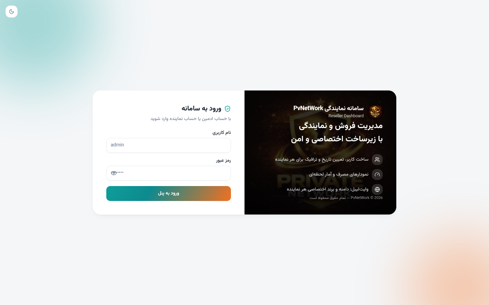 | **EN:** Secure login for admin and resellers. Supports 2FA (TOTP), rate limiting, and Persian RTL interface.<br>**FA:** ورود امن ادمین و نماینده‌ها با پشتیبانی از ورود دومرحله‌ای و رابط فارسی راست‌به‌چپ. |

### 2. Admin Dashboard | داشبورد ادمین

| | |
|---|---|
| 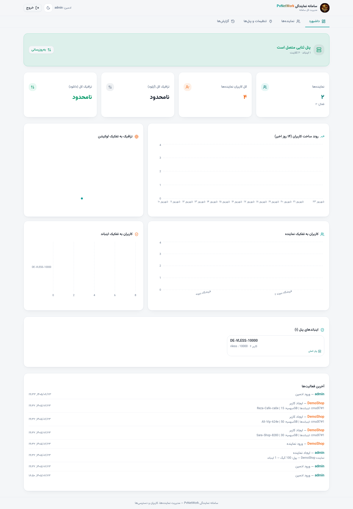 | **EN:** Main admin dashboard — reseller count, total users, traffic overview, 14-day user creation trend, traffic by location, and recent activity logs.<br>**FA:** داشبورد اصلی ادمین — تعداد نماینده‌ها، کاربران کل، نمای کلی ترافیک، روند ساخت کاربران و گزارش فعالیت‌ها. |

### 3. Reseller Management | مدیریت نماینده‌ها

| | |
|---|---|
| 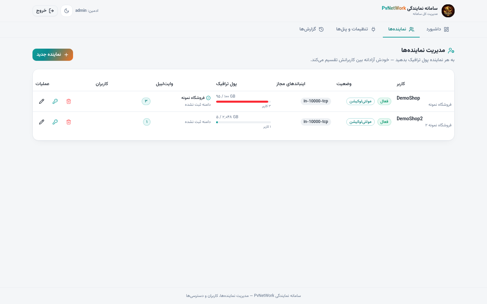 | **EN:** Manage resellers — set traffic pools, allowed inbounds, permissions (multi-location, IP limit, white-label). Each reseller independently distributes their pool among users.<br>**FA:** مدیریت نماینده‌ها — تعیین پول ترافیک، اینباندهای مجاز و دسترسی‌ها. هر نماینده سهمیه‌اش را آزادانه بین کاربرانش تقسیم می‌کند. |

| | |
|---|---|
| 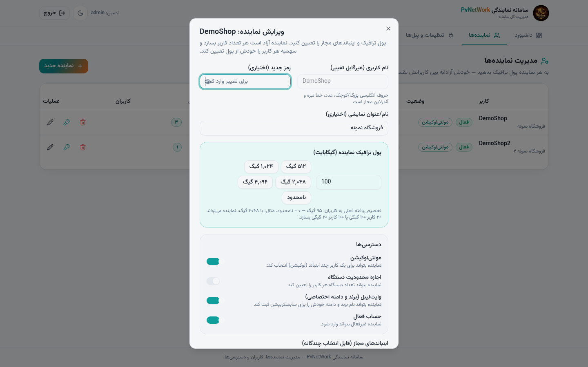 | **EN:** Edit reseller — traffic pool assignment with quick-pick presets, inbound permissions, and access toggles.<br>**FA:** ویرایش نماینده — تخصیص پول ترافیک با دکمه‌های سریع، دسترسی اینباند و کلیدهای کنترل. |

### 4. Panel Configuration | تنظیمات پنل

| | |
|---|---|
| 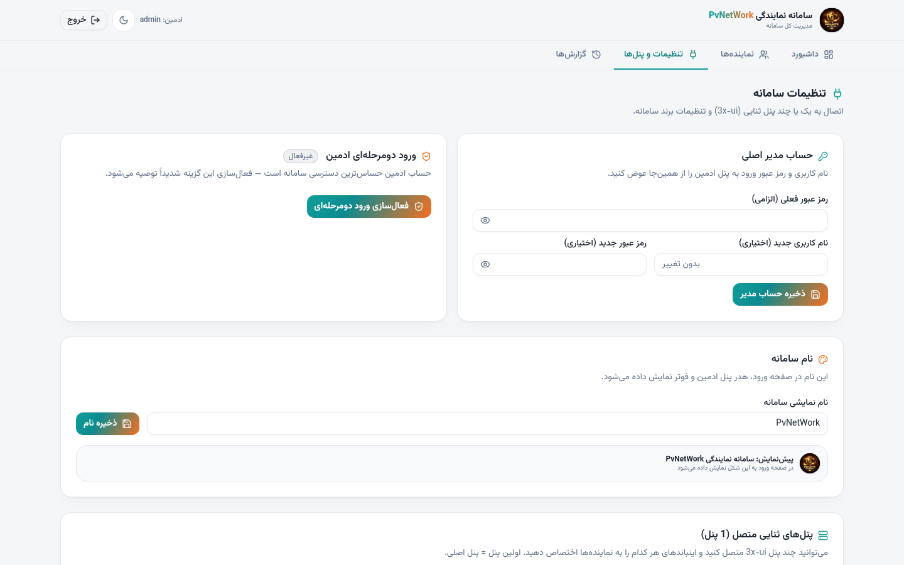 | **EN:** Connect multiple 3x-ui panels — test connection, manage API tokens, subscription URLs. The first panel is the primary.<br>**FA:** اتصال چند پنل 3x-ui — تست اتصال، مدیریت API Token و آدرس سابسکریپشن. اولین پنل = پنل اصلی. |

| | |
|---|---|
| 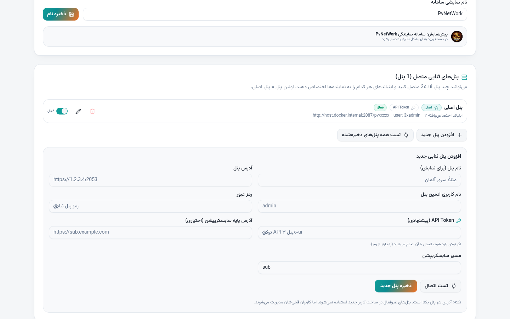 | **EN:** Connected panels list — each panel shows its URL, status, and inbound assignment count.<br>**FA:** لیست پنل‌های متصل — هر پنل با آدرس، وضعیت و تعداد اینباند اختصاص‌یافته. |

### 5. Reports | گزارش‌ها

| | |
|---|---|
| 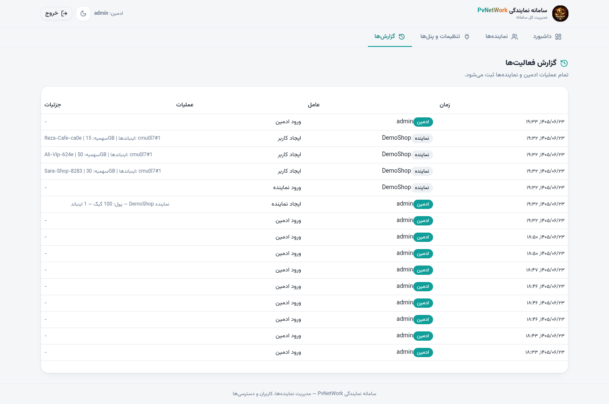 | **EN:** Activity logs — all admin and reseller operations are audited with timestamps.<br>**FA:** گزارش فعالیت‌ها — تمام عملیات ادمین و نماینده‌ها با زمان ثبت می‌شود. |

### 6. Reseller — My Users | نماینده — کاربران من

| | |
|---|---|
| 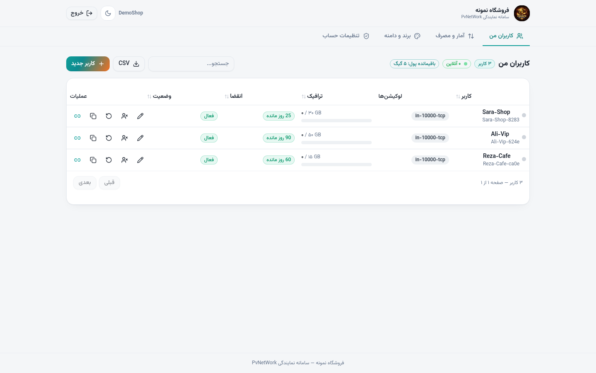 | **EN:** Reseller's main page — user list with canonical multi-panel traffic, quota remaining, online status. Create, edit, delete users. Fast bootstrap loading (one panel snapshot).<br>**FA:** صفحه اصلی نماینده — لیست کاربران با مصرف کانونی چندپنلی، باقیمانده پول و وضعیت آنلاین. ساخت، ویرایش و حذف کاربران. بارگذاری سریع (یک snapshot). |

| | |
|---|---|
| 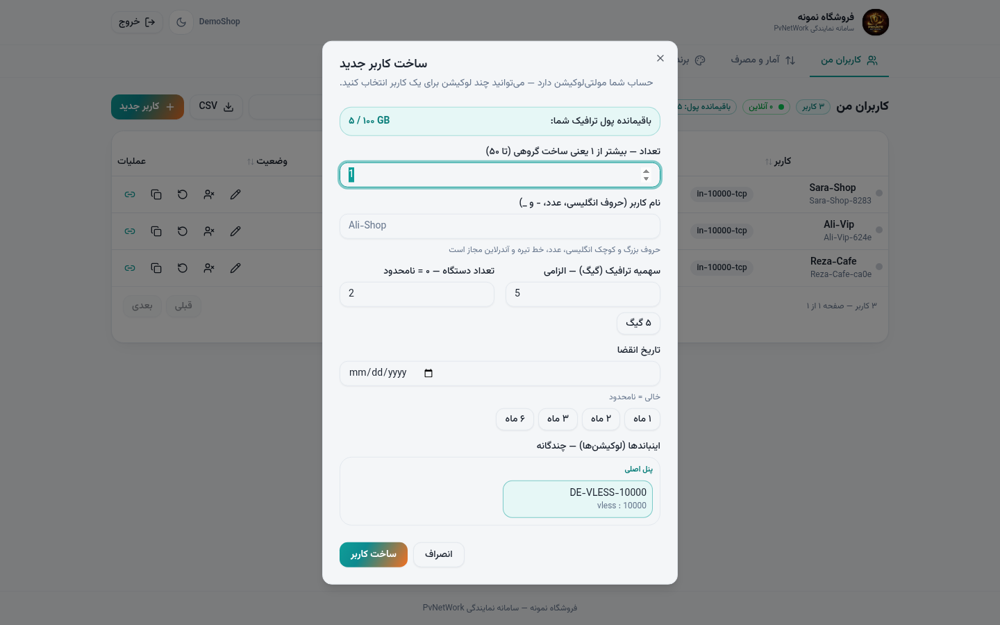 | **EN:** Create user — mobile-friendly numeric input (accepts Persian digits), quick-pick GB presets (5-100), multi-location selection, expiry presets. Supports `Idempotency-Key` header for safe retries.<br>**FA:** ساخت کاربر — ورودی عددی موبایل‌پسند (ارقام فارسی)، دکمه‌های سریع گیگ، انتخاب لوکیشن و انقضا. با پشتیبانی از `Idempotency-Key` برای retry امن. |

| | |
|---|---|
| 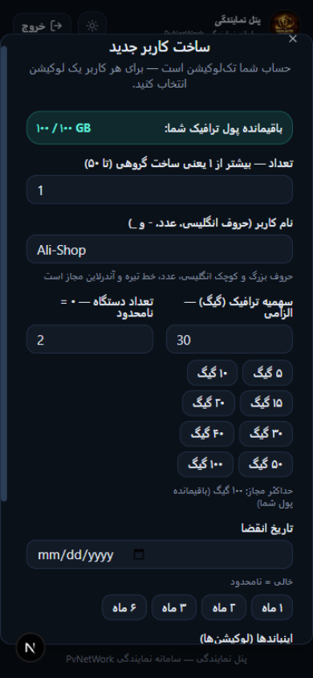 | **EN:** Mobile view — the create dialog works perfectly on phones. Persian digit input, 30/40 GB presets, and all controls are touch-friendly.<br>**FA:** نمای موبایل — دیالوگ ساخت کاربر روی گوشی کامل کار می‌کند. ارقام فارسی، پیشنهاد ۳۰/۴۰ گیگ و کنترل‌های لمسی. |

### 7. Reseller — Stats & Usage | نماینده — آمار و مصرف

| | |
|---|---|
| 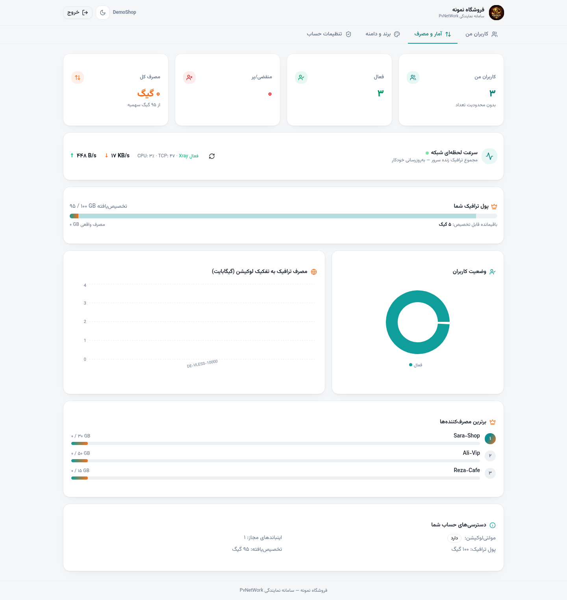 | **EN:** Traffic statistics — usage by location, top users, traffic pool summary. Loaded lazily (only when this tab opens) for fast initial page load.<br>**FA:** آمار ترافیک — مصرف به تفکیک لوکیشن، کاربران برتر و خلاصه پول. بارگذاری تنبل (فقط با باز شدن تب) برای سرعت صفحه اول. |

### 8. Reseller — Links & QR | نماینده — لینک‌ها

| | |
|---|---|
| 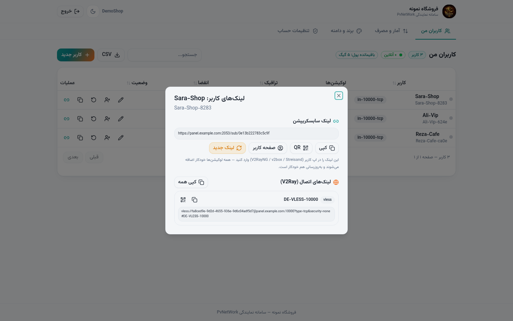 | **EN:** User subscription links — copy, QR code, V2Ray config links for each location.<br>**FA:** لینک‌های اشتراک کاربر — کپی، QR کد و لینک‌های V2Ray برای هر لوکیشن. |

### 9. Reseller — Brand & Domain | نماینده — برند و دامنه

| | |
|---|---|
| 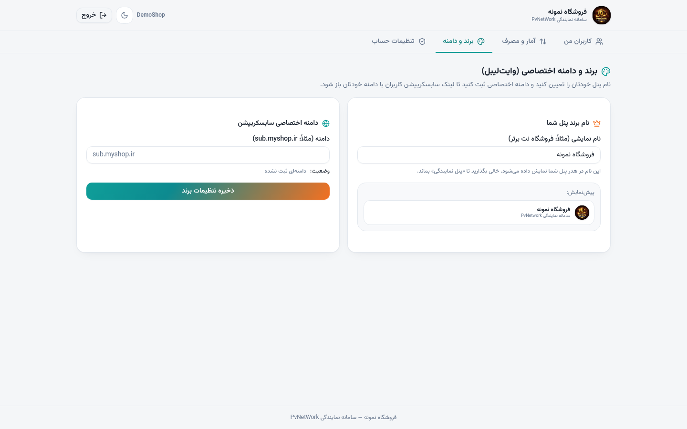 | **EN:** White-label branding — custom brand name, custom subscription domain with DNS verification.<br>**FA:** برند اختصاصی — نام برند سفارشی، دامنه اختصاصی سابسکریپشن با تأیید DNS. |

### 10. Reseller — Account Settings | نماینده — تنظیمات حساب

| | |
|---|---|
| 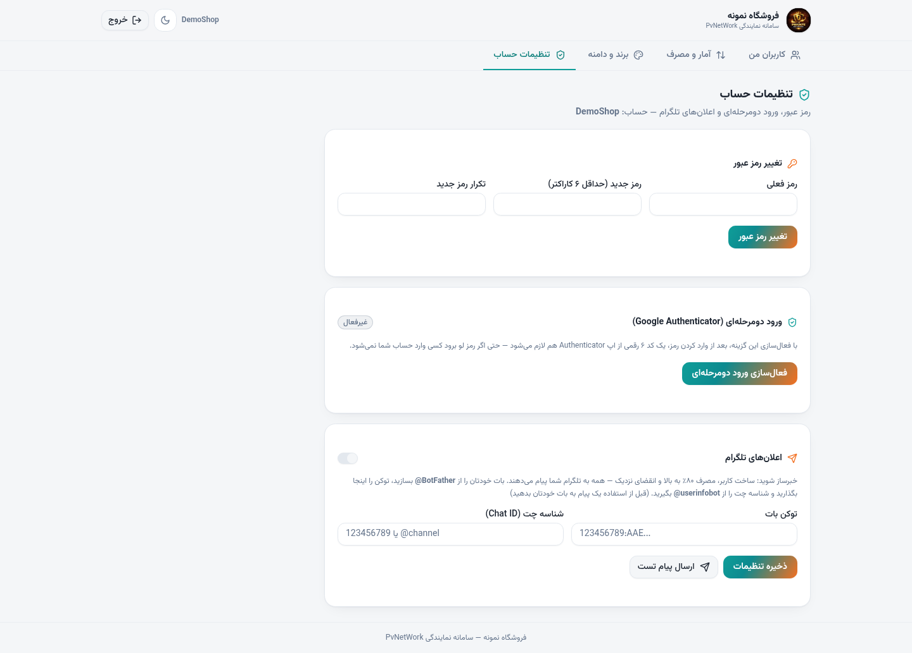 | **EN:** Account settings — change password, enable 2FA (TOTP), Telegram notifications.<br>**FA:** تنظیمات حساب — تغییر رمز، ورود دومرحله‌ای، اعلان‌های تلگرام. |

### 11. Mirza Bot Connection | اتصال ربات میرزا

| | |
|---|---|
| 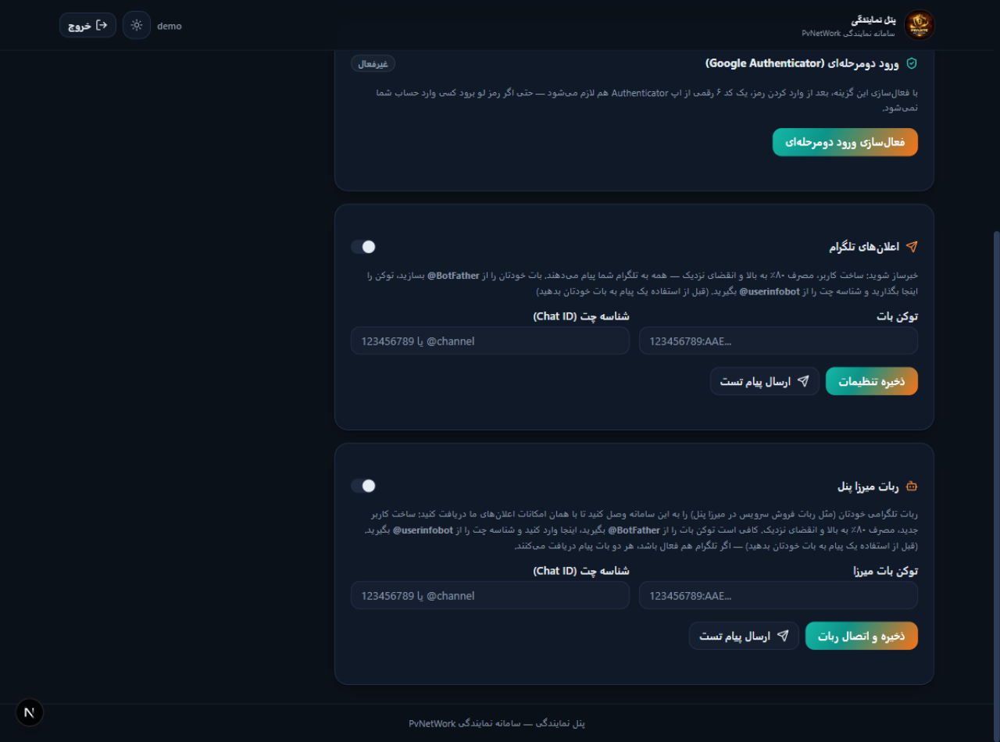 | **EN:** Connect your Mirza bot — enable the switch, copy the panel URL and credentials, enter the inbound ID from the self-test. Full visual guide at `/guide/mirza-bot`.<br>**FA:** ربات خود را وصل کنید — سوییچ را روشن کنید، آدرس و مشخصات را کپی کنید و شناسه اینباند را از تست اتصال بگیرید. راهنمای کامل در `/guide/mirza-bot`. |

| | |
|---|---|
| 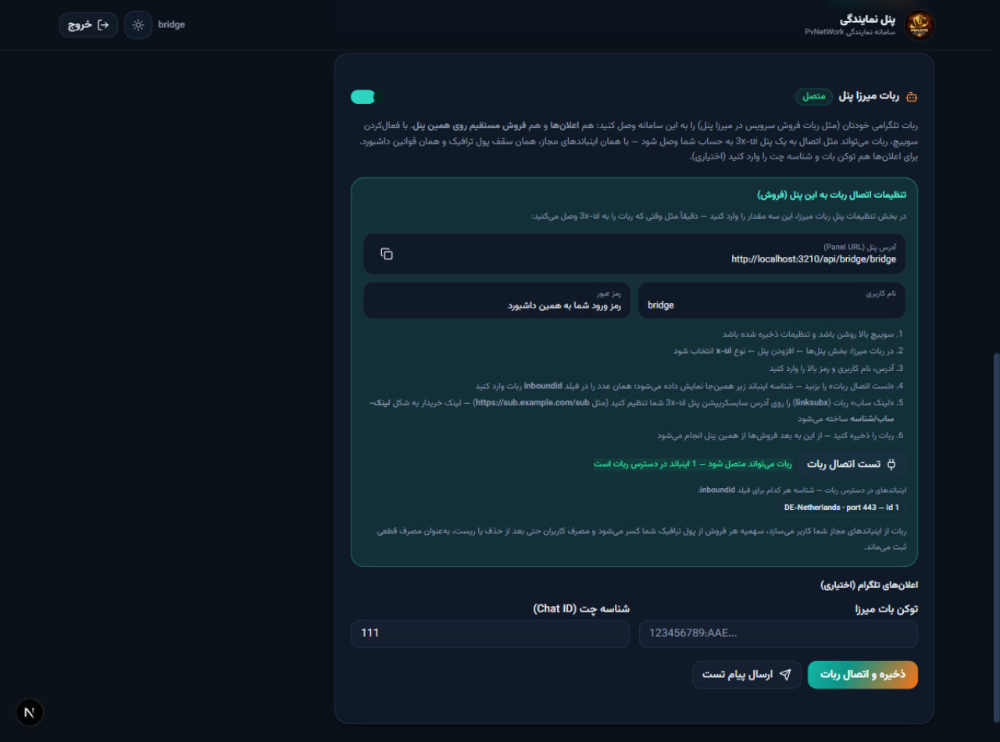 | **EN:** Bridge connection details — the green box shows the panel URL, username, and password hint. The "Test Connection" button verifies inbound access.<br>**FA:** جزئیات اتصال پل — جعبه سبز شامل آدرس پنل، نام کاربری و راهنمای رمز. دکمه «تست اتصال ربات» دسترسی اینباند را بررسی می‌کند. |

### 12. Public Subscription Portal | پرتال عمومی اشتراک

| | |
|---|---|
| 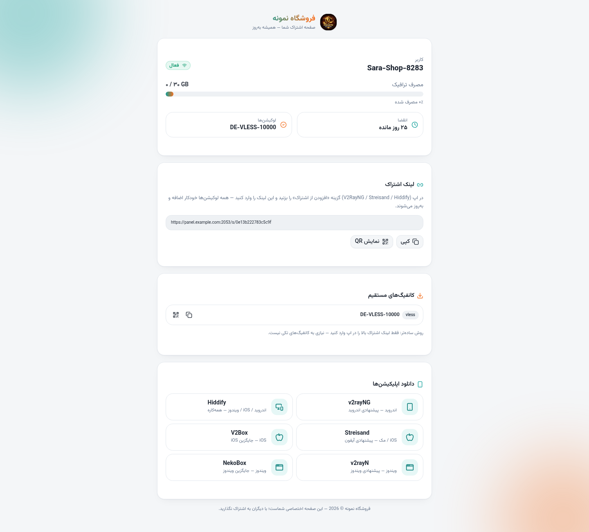 | **EN:** End-user portal — subscription status, remaining traffic, expiry date, and all connection links. Accessible via `https://your-domain/sub/<subId>`.<br>**FA:** پرتال کاربر نهایی — وضعیت اشتراک، ترافیک باقیمانده، تاریخ انقضا و لینک‌های اتصال. با آدرس `https://your-domain/sub/<subId>`. |

| | |
|---|---|
| 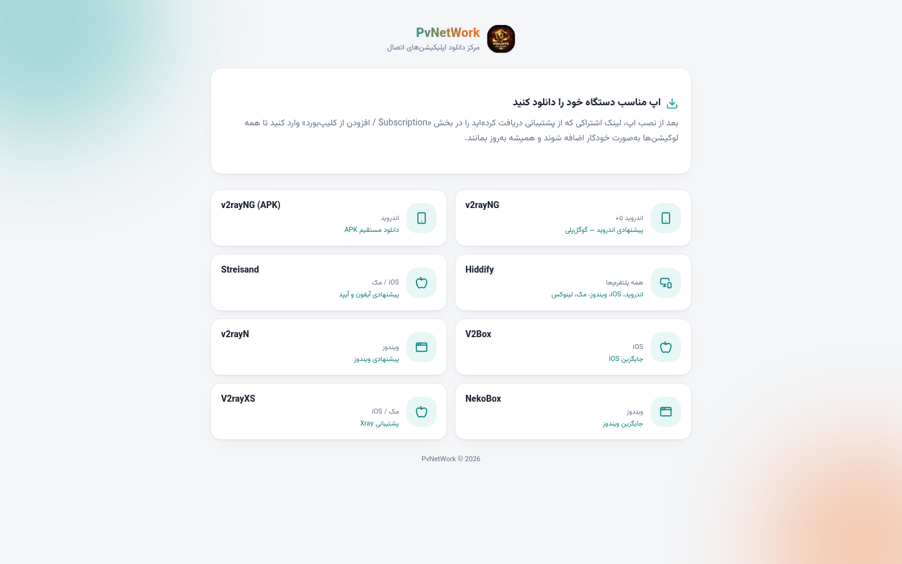 | **EN:** App recommendations — suggested V2Ray/Clash clients for each platform.<br>**FA:** اپ‌های پیشنهادی — کلاینت‌های V2Ray/Clash برای هر پلتفرم. |

## 🔗 Mirza Bot Setup (Step by Step)

Full visual walkthrough: [docs/guide-mirza-bot.fa.md](docs/guide-mirza-bot.fa.md) — or open `/guide/mirza-bot` on your dashboard.

| Step | Action |
|---|---|
| 1 | Settings → "ربات میرزا پنل" → enable switch → Save |
| 2 | Copy Panel URL, Username, Password from the green box |
| 3 | In your Mirza bot: Panels → Add Panel → Type: `x-ui` |
| 4 | Paste URL, username, password |
| 5 | Click "تست اتصال ربات" — copy the inbound ID shown |
| 6 | Enter that ID in the bot's `inboundid` field |
| 7 | Set `linksubx` to your 3x-ui subscription URL |
| 8 | Save — sales now go through your panel |

## 🛡️ Security & Accounting

| Feature | Status |
|---|---|
| Limited reseller → unlimited user | ✅ Impossible |
| Traffic pool bypass (delete/reset/recreate) | ✅ Blocked (permanent debit) |
| Concurrent quota overspend | ✅ Atomic lock |
| Multi-panel partial failure | ✅ Operation journal + retry |
| Crash-safe accounting | ✅ Single transaction commit |
| CREATE idempotency | ✅ `Idempotency-Key` header |
| UPDATE delta reservation | ✅ Durably reserved |
| Canonical traffic (multi-panel) | ✅ Single source |
| subId collision | ✅ Unique index |
| Unsafe reseller deletion | ✅ 409 when users exist |
| Admin pool below obligations | ✅ 409 + explicit override |

## 🏗️ Architecture

```text
Browser / Cloudflare → Apache :443 → Docker (127.0.0.1:31080) → external 3x-ui panels
                                                            ↘ SQLite (volume-mounted)
```

## 📦 Install Layout

```text
/opt/pv-reseller/
├── app/          # Git checkout
├── data/custom.db
├── backup/
├── .env
└── INITIAL_CREDENTIALS.txt
```

## 🔄 Update

```bash
bash /opt/pv-reseller/app/update.sh
```

Safe: backup → additive migration → candidate build → health check → swap. Auto-rollback on failure.

## 📋 Requirements

- Ubuntu/Debian, root access, 4 GiB free disk
- Domain with DNS pointing to your server
- Ports 80/443 available

---

<div align="center">

**PvNetWork** © 2026 — [npanel.softarg.ir](https://npanel.softarg.ir)

</div>
