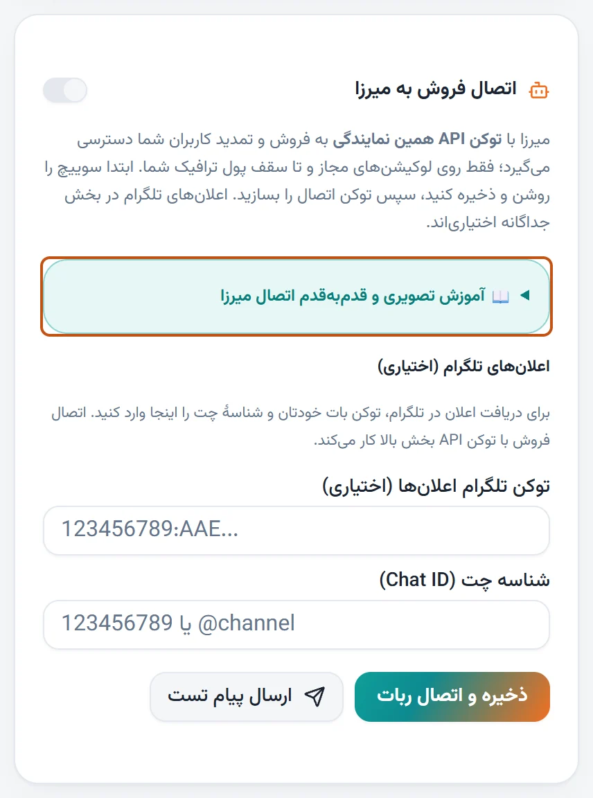

# آموزش نصب و اتصال میرزا، از صفر تا ساب

آموزش تعاملی ۱۰ مرحله‌ای در **تنظیمات حساب ← اتصال فروش به میرزا ← آموزش تصویری و قدم‌به‌قدم** قرار دارد. نسخهٔ جدا: [`/guide/mirza-bot`](https://npanel.softarg.ir/guide/mirza-bot).



هر مرحله تصویر نمونه، محل انجام کار، دکمهٔ موردنظر و نتیجهٔ موردانتظار دارد. «مرحله بعد»، «قبلی» و دکمه‌های شماره‌دار فقط آموزش را جابه‌جا می‌کنند؛ تنظیمات، توکن و موجودی را تغییر نمی‌دهند. تصاویر با اطلاعات ساختگی ساخته شده‌اند و هیچ کلید واقعی داخلشان نیست.

مراحل اتصال با **میرزا ۰٫۸٫۱، نوع 3x-ui / x-ui_single** تطبیق داده شده‌اند. اتصال را با دسترسی مدیر ربات از تلگرام تنظیم می‌کنی.

## اگر هنوز ربات نداری

۱. در BotFather فرمان `/newbot` بفرست. اسم نمایشی و یک نام کاربری یکتا که به `bot` ختم شود بده. توکن تلگرام و لینک ربات را از پاسخ بردار. توکن تلگرام برای نصب ربات استفاده می‌شود. توکن فروش را بعداً از تنظیمات حساب نمایندگی می‌گیری. [BotFather](https://t.me/BotFather) · [راهنمای ساخت ربات تلگرام](https://core.telegram.org/bots/features#botfather)

۲. برای ربات یک سرور تازه با Ubuntu 22.04 یا 24.04 آماده کن. در DNS دامنه، یک رکورد `A` برای زیردامنهٔ ربات بساز و IPv4 سرور ربات را وارد کن. از Windows Terminal یا PowerShell با SSH به همان سرور وصل شو. این IP فقط نمونه است و باید با آدرس سرور خودت عوض شود.

```bash
ssh root@203.0.113.10
```

۳. آیدی عددی حساب مدیر تلگرام را آماده کن. اگر آن را نداری، پیش از نصب، در چت خصوصی ربات تازهٔ خودت از حساب مدیر `/start` بفرست. فرمان‌ها را روی سرور ربات اجرا کن. خط اول توکن تلگرام را با ورودی پنهان می‌گیرد. عدد `message.from.id` را از پاسخ بردار و توکن و پاسخ کامل را خصوصی نگه دار. اگر `result` خالی بود، پیام تازه‌ای به ربات بفرست و دوباره امتحان کن. [مرجع Telegram Bot API](https://core.telegram.org/bots/api#getupdates)

```bash
read -rsp 'Bot token: ' BOT_TOKEN; printf '\n'
curl -fsS "https://api.telegram.org/bot${BOT_TOKEN}/getUpdates?timeout=0"
unset BOT_TOKEN
```

۴. دستور نصب را از صفحهٔ رسمی میرزا بگیر و روی سرور تازه اجرا کن. در منو `1 (Install)` را انتخاب و توکن BotFather، آیدی عددی مدیر و زیردامنهٔ ربات را در درخواست‌های نصب‌کننده وارد کن. بعد از پایان، از حساب مدیر به ربات `/start` بفرست و با `/panel` منوی مدیریت را باز کن. اگر پاسخی نگرفتی، در ترمینال سرور با دستور `mirza` وضعیت وب‌هوک و SSL را ببین. [دستور رسمی نصب روی سرور](https://github.com/mahdiMGF2/mirzabot#-installation)

## اگر اتصال از قبل وجود دارد

اگر میرزا وضعیت پنل و کاربر نمونه را می‌خواند، اتصال تازه اضافه نکن و توکن معتبر را دوباره نساز؛ صدور کلید جدید قبلی را باطل می‌کند. از مرحلهٔ ۶ ادامه بده. خطای قدیمیِ تغییر نام پنل، به‌تنهایی نشان‌دهندهٔ قطع اتصال فعلی نیست.

**نام پنل در میرزا** یک عنوان دلخواه است. **نام نمایندگی** داخل Panel URL خودت است. **نام کاربری کانفیگ نمونه** متن ریز زیر نام یکی از مشتری‌های همان نمایندگی است. در «تنظیم پروتکل و اینباند» فقط نام کاربری کانفیگ نمونه را بفرست.

## ۱. تنظیمات حساب را باز کن

وارد نمایندگی خودت شو. «تنظیمات حساب» و سپس کارت «اتصال فروش به میرزا» را پیدا کن.

## ۲. اتصال را روشن و ذخیره کن

سوییچ کارت را روشن کن و پایین همان کارت «ذخیره و اتصال ربات» را بزن. برچسب «فعال» باید دیده شود. قسمت اعلان‌های تلگرام برای فروش اختیاری است.

## ۳. توکن API مخصوص فروش را بساز

«ساخت توکن API» را بزن و با علامت کپی کنار توکن، آن را بردار. **قبل از خروج یا بازخوانی صفحه کپی‌اش کن**؛ توکن فقط همان بار قابل کپی است.

این کلید، توکن تلگرام و رمز ورود داشبورد نیست. با تعویض، لغو، خاموش‌کردن اتصال یا تغییر تنظیمات ورود، کلید قبلی نامعتبر می‌شود. بعد از تعویض، مقدار جدید را در میرزا جایگزین کن.

## ۴. در ربات میرزا پنل اضافه کن

با حساب مدیر وارد ربات شو: **«🖥 اضافه کردن پنل» ← «3x-ui»**. یک نام دلخواه مثل «فروش من» بفرست.

اگر اتصال از قبل وجود دارد، از **«✏️ مدیریت پنل»** همان اتصال را انتخاب و ویرایش کن؛ اتصال تکراری لازم نیست.

## ۵. آدرس پنل و توکن فروش را بفرست

وقتی میرزا آدرس خواست، **«آدرس پنل (Panel URL)»** را از کارت نمایندگی خودت کپی کن. نمونهٔ آموزشی:

```text
https://npanel.softarg.ir/api/bridge/YOUR_USERNAME
```

`YOUR_USERNAME` نمونه است؛ مقدار حساب خودت را کپی کن. سپس وقتی میرزا **«توکن را ارسال نمایید»** گفت، توکن API فروش مرحلهٔ ۳ را بفرست. این نسخه برای `x-ui_single` نام کاربری و رمز ورود داشبورد را جداگانه نمی‌پرسد.

## ۶. کاربر نمونهٔ مناسب آماده کن

نمونه باید متعلق به **همین نمایندگی** باشد و **فقط لوکیشن‌های مجاز و آنلاین موردنظر فروش** را داشته باشد. از کاربر موجودی با همین شرایط استفاده کن. کاربر قدیمی با لوکیشن آفلاین مناسب این مرحله نیست.

اگر نمونه نداری، یک کاربر آزمایشی با حداقل **۱ گیگ کامل** و لوکیشن‌های آنلاین بساز؛ **حجمش از موجودی تو تخصیص می‌یابد**. این دو مقدار را از همان کاربر بردار:

- **نام کاربری داخلی:** متن ریز زیر نام نمایشی کاربر؛ عبارت `SAMPLE_CUSTOMER_ID` در تصاویر فقط مثال است و نباید همان را بفرستی.
- **لینک کامل ساب:** لینک خود کاربر با شناسهٔ اشتراک در انتها؛ از دکمهٔ لینک ساب همان ردیف کپی کن.

## ۷. لوکیشن‌ها را در میرزا انتخاب کن

**مدیریت پنل ← اتصال خودت ← «⚙️ تنظیم پروتکل و اینباند»**.

وقتی نام کاربری کانفیگ خواست، **نام کاربری داخلی کاربر نمونه** را بفرست. در میرزا ۰٫۸٫۱ این مرحله لوکیشن‌های کاربر نمونه را می‌خواند؛ نام نمایشی، شمارهٔ تلگرام یا آرایهٔ عددی اینباندها را جای نام کاربری نفرست.

میرزا باید پیام ذخیره‌شدن اینباندها را نشان دهد. نام این گزینه در میرزا شامل «پروتکل» است، اما اتصال ما فقط لوکیشن‌های فروش را انتخاب می‌کند و اجازهٔ تغییر پروتکل یا روتینگ سرور ندارد.

## ۸. لینک کامل ساب نمونه را تنظیم کن

**مدیریت پنل ← اتصال خودت ← «🔗 دامنه لینک ساب»**.

وقتی میرزا یک لینک ساب کاربر خواست، **لینک کامل همان کاربر نمونه** را بفرست. مثال ساختگی:

```text
https://subscription.example/sub/EXAMPLE_SUB_ID
```

از «لینک‌ها و QR کاربر»، مقدار «لینک اصلی سابسکریپشن» همان کاربر را کپی کن. `EXAMPLE_SUB_ID` شناسهٔ ساختگی است و نشانی پایه برای هر پنل می‌تواند فرق کند.

میرزا لینک کامل را باز و بررسی می‌کند و سپس خودش قسمت آخر را جدا می‌کند. مقدار ذخیره‌شدهٔ `linksubx` در تنظیمات/API پایهٔ همان لینک است. در مثال بالا به این شکل ذخیره می‌شود.

```text
https://subscription.example/sub
```

تفاوت مهم: **پاسخ به پیام ربات = لینک کامل نمونه؛ مقدار نهایی `linksubx` = آدرس پایه**.

## ۹. بسته‌ها و اکانت تست را تنظیم کن

بسته‌ها باید عدد صحیح گیگابایت و حداقل **۱ گیگ** باشند؛ مثلاً ۱۰ گیگ با مدت ۳۰ روز. قیمت و مدت را خودت تعیین کن.

در فیلد حجم اکانت تست، یک عدد صحیح مثبت به **مگابایت** وارد کن. برای نمونه، ۱۰۰ یعنی ۱۰۰ مگابایت و ۱۰۲۴ یعنی ۱ گیگ. موجودی نمایندگی باید برای همین حجم کافی باشد.

**زمان اکانت تست در این نسخه ساعت است**: ۱ یعنی یک ساعت؛ ۲۴ یعنی یک روز. مدت بستهٔ پولی روز است. این مثال‌ها دستور تغییر محصول، قیمت یا مدت فعلی نیستند.

## ۱۰. نتیجه را بررسی کن

در کارت اتصال نمایندگی، «بررسی لوکیشن‌های قابل فروش» باید فهرست لوکیشن‌های آنلاین و مجاز را نشان دهد. این دکمه دسترسی و لوکیشن‌ها را بررسی می‌کند؛ به معنی انجام خرید واقعی از ربات نیست.

در خود میرزا یک اشتراک آزمایشی از همان پنل بگیر. پرداخت واقعی لازم نیست و حجم تست از موجودی نمایندگی تخصیص می‌یابد. در «کاربران من» دنبال یک حساب تازه بگرد، لینک ساب آن را در برنامهٔ کاربر وارد کن و ببین لوکیشن‌های انتخاب‌شده در فهرست کانفیگ هستند. حذف یا ریست، مصرف انجام‌شده را به موجودی برنمی‌گرداند.

پیام «اینباندها ذخیره شدند» فقط انتخاب لوکیشن را تأیید می‌کند؛ اثبات ساخت کاربر یا تکمیل خرید نیست. اگر پاسخ ساخت نامعلوم بود، پیش از تکرار یا پرداخت دوباره، فهرست کاربران را بررسی کن.

## خطاهای رایج

| خطا | کدام مرحله را بررسی کنم؟ |
|---|---|
| توکن نامعتبر / دسترسی غیرمجاز | ۳ و ۵: توکن فروش همین نمایندگی، اتصال روشن و ذخیره‌شده و آدرس مخصوص همین حساب |
| کاربر پیدا نشد / اینباندها تنظیم نشدند | ۶ و ۷: نام کاربری داخلی، مالکیت همین نمایندگی و نمونه با لوکیشن‌های آنلاین |
| لینک ساب قبول نمی‌شود | ۸: لینک کامل شامل شناسهٔ کاربر، نه آدرس پایه |
| هیچ لوکیشن قابل فروشی نیست | دسترسی اعطاشده و آنلاین‌بودن لوکیشن را با مدیر بررسی کن |
| اکانت تست ساخته نمی‌شود | ۹: حجم را با یک عدد صحیح مثبت به مگابایت وارد کن و موجودی نمایندگی را بررسی کن |
| فقط کد ۴۰۰ دیده می‌شود | این کد علت را مشخص نمی‌کند؛ نام داخلیِ مشتری، موجودی و لوکیشن‌ها را بررسی کن. رابط به‌روز علت رد API را همراه کد نشان می‌دهد؛ اتصال تکراری و تعویض بی‌دلیل توکن لازم نیست |

کلید هر نمایندگی فقط به مشتری‌ها، سقف موجودی و لوکیشن‌های مجاز همان نمایندگی دسترسی می‌دهد. راهنمای تصویری از اطلاعات نمونه استفاده می‌کند و هیچ عمل واقعی را خودکار انجام نمی‌دهد.
