# راهنمای تصویری پنل نمایندگی

از فهرست، کاری را که می‌خواهید انجام دهید انتخاب کنید. کادرهای نارنجی نشان می‌دهند کجا بزنید. روی هر عکس بزنید تا در اندازهٔ اصلی باز شود. عکس‌ها از حساب نمونه گرفته شده‌اند.

## تمدید خودکار و شروع دورهٔ جدید

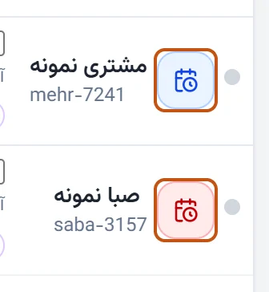

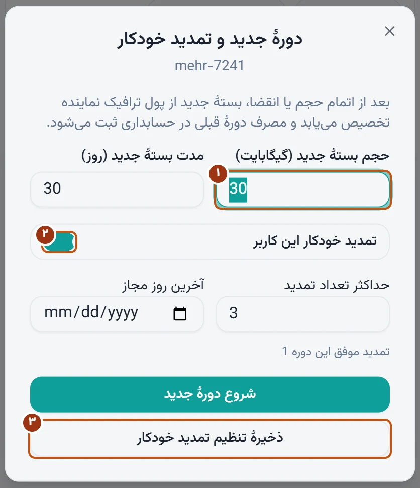

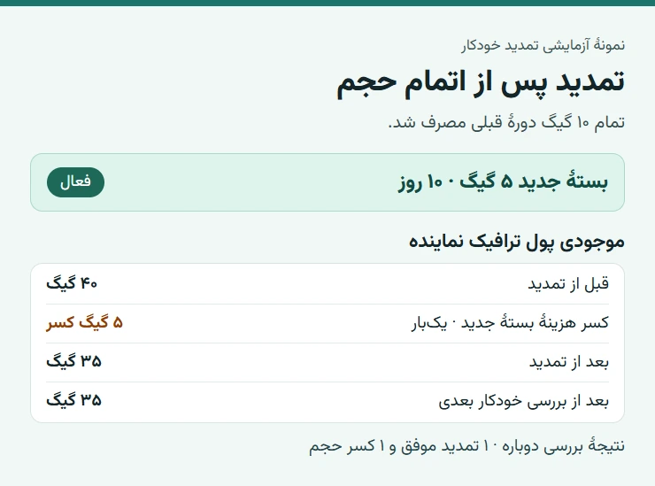

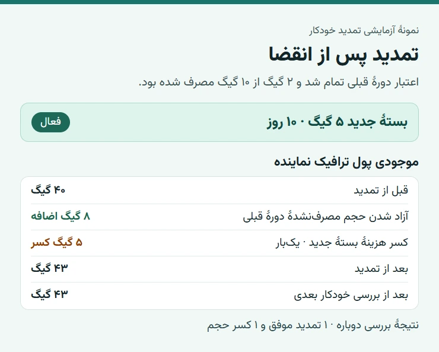

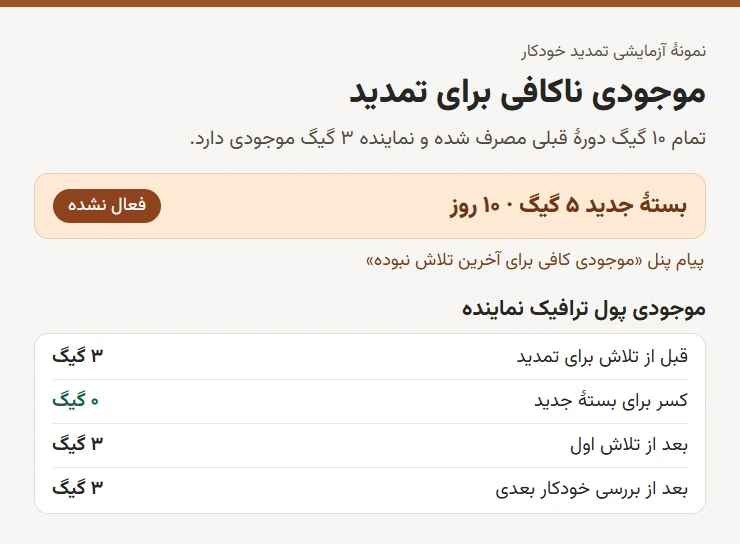

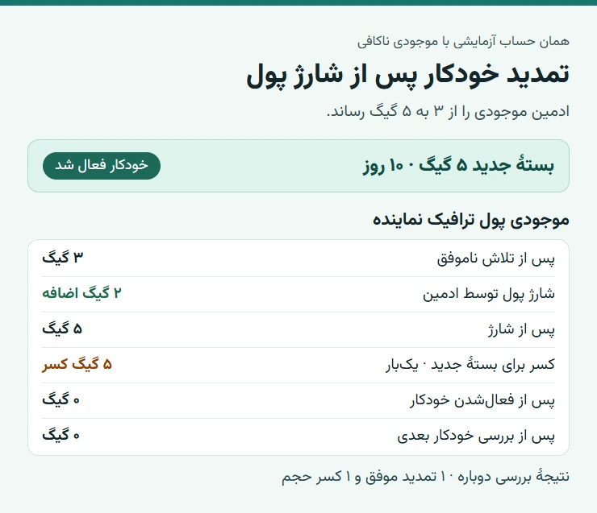

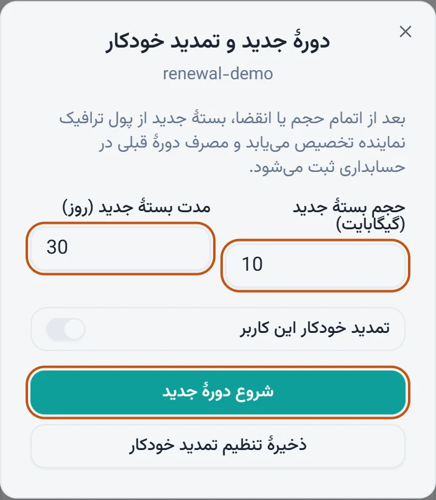

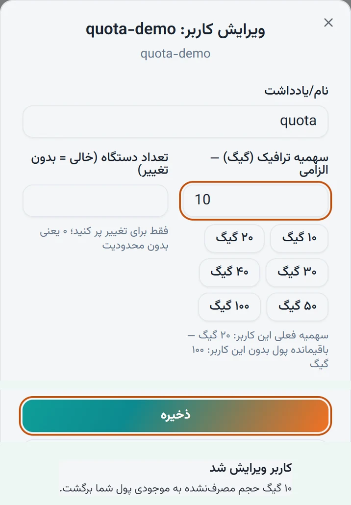

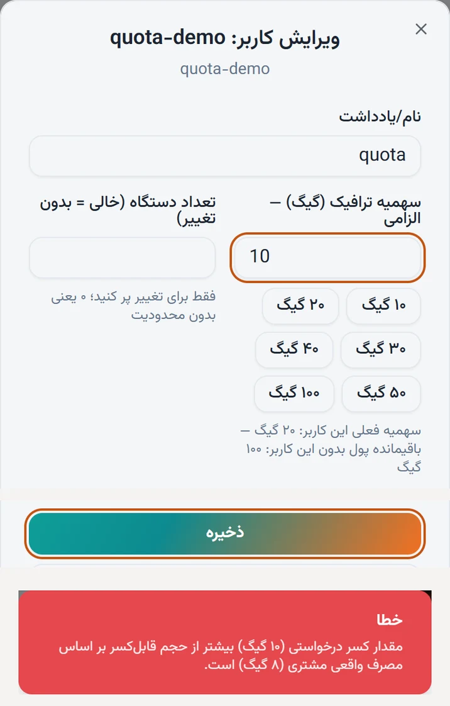

**مسیر نماینده** › کاربران من › آیکون تقویم و ساعت کنار نام مشتری

1. مشتری را با جستجو پیدا کنید. آیکون **آبی** یعنی تنظیم تمدید خودکار روشن است و **قرمز** یعنی خاموش است. برای دیدن تنظیمات و علت توقف احتمالی روی همان آیکون بزنید.
2. در پنجرهٔ «دورهٔ جدید و تمدید خودکار»، حجم دورهٔ بعد را به گیگابایت و مدت آن را به روز وارد کنید. برای نمونه، ۱۰ گیگ و ۳۰ روز.
3. سوییچ **تمدید خودکار این کاربر** را روشن کنید. در صورت نیاز، «حداکثر تعداد تمدید» یا «آخرین روز مجاز» را هم وارد کنید. هرکدام را خالی بگذارید، همان محدودیت اعمال نمی‌شود.
4. **ذخیرهٔ تنظیم تمدید خودکار** را بزنید. رنگ کنار نام کاربر همان لحظه به‌روز می‌شود. تعداد تمدید موفق و علت توقف احتمالی داخل پنجره دیده می‌شوند.
5. برای خاموش‌کردن، سوییچ را خاموش کنید و دوباره **ذخیرهٔ تنظیم تمدید خودکار** را بزنید. برای آغاز فوری یک دورهٔ پولی، دکمهٔ **شروع دورهٔ جدید** را بزنید.

**دو نمونهٔ تمدید خودکار با بستهٔ ۵ گیگی**

- **اتمام حجم.** از بستهٔ قبلی ۱۰ گیگ مصرف شده است. با فعال‌شدن بستهٔ ۵ گیگیِ ۱۰روزه، موجودی پول ترافیک از **۴۰ به ۳۵ گیگ** می‌رسد.
- **انقضا.** اعتبار بستهٔ ۱۰ گیگی تمام شده و مشتری ۲ گیگ مصرف کرده است. **۸ گیگ آزاد می‌شود** و پس از تخصیص بستهٔ ۵ گیگیِ ۱۰روزه، موجودی از **۴۰ به ۴۳ گیگ** می‌رسد.

در هر دو آزمایش، پنل بستهٔ جدید را فعال کرد و **۵ گیگ فقط یک‌بار** برای آن تخصیص داد. بررسی خودکار بعدی همان نتیجه را نشان داد.

**نمونهٔ موجودی ناکافی برای تمدید خودکار**

بستهٔ قبلی کامل مصرف شده و پول ترافیک نماینده **۳ گیگ** است. پنل هنگام تلاش برای تمدید بستهٔ **۵ گیگی** پیام «موجودی کافی برای آخرین تلاش نبوده» را نشان می‌دهد. بستهٔ تازه فعال نمی‌شود، **کسر حجم صفر** است و موجودی پس از بررسی خودکار بعدی هم **۳ گیگ** است.

**نمونهٔ ادامهٔ تمدید خودکار پس از شارژ**

در همان حساب آزمایشی، ادمین **۲ گیگ** به پول ترافیک نماینده اضافه کرد و موجودی از **۳ به ۵ گیگ** رسید. در نوبت بعدی بررسی، پنل بستهٔ **۵ گیگیِ ۱۰روزه** را با همان لینک اشتراک فعال کرد و **فقط یک‌بار ۵ گیگ کسر شد**. بعد از فعال‌شدن، موجودی صفر بود و بررسی بعدی هم همان یک تمدید و موجودی صفر را نشان داد.

**مثال شروع دورهٔ ۱۰ گیگی پس از مصرف ۴۰ گیگ**

در «کاربران من» روی آیکون تقویم کنار نام مشتری بزنید. وقتی ۴۰ گیگ دورهٔ قبلی کامل مصرف شده، در «حجم بستهٔ جدید» **۱۰ گیگ** و در مدت، مثلاً **۳۰ روز** وارد کنید. سپس **شروع دورهٔ جدید** را بزنید.

**۴۰ گیگ مصرف قبلی** در حسابداری ثبت می‌ماند. مصرف دورهٔ جدید از صفر شروع می‌شود و **فقط ۱۰ گیگ** از موجودی نماینده کم می‌شود. اگر پیش از تمدید ۶۰ گیگ موجودی داشتید، پس از آن ۵۰ گیگ باقی می‌ماند.

**مثال کاهش سهمیه از ۲۰ به ۱۰ گیگ با ۵ گیگ مصرف**

در «کاربران من»، در ستون «عملیات» روی آیکون **مداد** بزنید. در «سهمیه ترافیک (گیگ)» عدد **۱۰** را به‌عنوان سهمیهٔ کل وارد کنید و **ذخیره** را بزنید.

بعد از تأیید تغییر در لوکیشن‌ها، **۵ گیگ مصرف قبلی ثبت می‌ماند** و مشتری از سهمیهٔ جدیدِ ۱۰ گیگی، **۵ گیگ برای مصرف** دارد. **۱۰ گیگ به موجودی نماینده برمی‌گردد**. در این مثال موجودی نماینده از ۸۰ به ۹۰ گیگ می‌رسد. فقط از حجم مصرف‌نشده می‌توانید کم کنید.

**مثال خطا با ۱۲ گیگ مصرف از بستهٔ ۲۰ گیگی**

اگر در ویرایش، سهمیه را از **۲۰ به ۱۰ گیگ** تغییر دهید، پنل درخواست را رد می‌کند. از بسته فقط **۸ گیگ مصرف‌نشده** باقی مانده، پس حداکثر همین ۸ گیگ را می‌توانید کم کنید. **کمترین سهمیه‌ای که می‌توانید وارد کنید ۱۲ گیگ است**، یعنی همان حجمی که مشتری مصرف کرده است.

از فرم **ویرایش کاربر** هم می‌توانید **بستهٔ جدید و سهمیهٔ دورهٔ قبلی** را باز کنید. حجم کل و مدت بسته را وارد کنید و **ثبت حجم و مدت بسته** را بزنید. برای اعمال بستهٔ ثبت‌شده، **شروع بستهٔ جدید** را جداگانه بزنید.

در همان بخش می‌توانید سهمیهٔ نمایشی آخرین دورهٔ بسته‌شده را اصلاح کنید. مصرف واقعی همان دوره کنار سهمیهٔ اصلاح‌شده دیده می‌شود. این اصلاح فقط در سابقه ثبت می‌شود.

تمدید خودکار برای هر کاربر جداگانه تنظیم می‌شود و پیش‌فرض خاموش است. با تمام‌شدن حجم یا رسیدن انقضا، هرکدام زودتر باشد، پنل با موجودی کافی دورهٔ تازه را از پول ترافیک نماینده تخصیص می‌دهد. مصرف دورهٔ قبلی در حسابداری ثبت می‌شود. غیرفعال‌سازی دستی از پنل، تمدید خودکار را متوقف می‌کند. فعال‌سازی دستی یا شروع دستی یک دورهٔ جدید این توقف را برمی‌دارد. عملیاتی که قبلاً ثبت و آغاز شده ممکن است بعد از خاموش‌کردن سوییچ هم به پایان برسد.

اگر هر دو سقف را وارد کنید، اولین سقفی که برسد تمدیدهای بعدی را متوقف می‌کند. «آخرین روز مجاز» تا پایان همان روز در منطقهٔ زمانی مرورگر اعتبار دارد. فقط تمدیدهای تأییدشده در شمارنده ثبت می‌شوند. تغییر حجم، مدت یا سقف‌ها شمارنده را حفظ می‌کند. خاموش‌کردن، ذخیره و سپس روشن‌کردن و ذخیرهٔ مجدد شمارندهٔ جدید می‌سازد.

## منوهای پنل نماینده

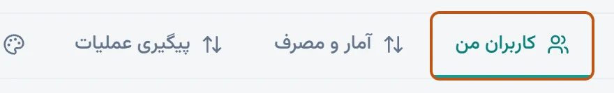

- **کاربران من** با آیکون افراد، برای ساخت، جستجو، ویرایش و تحویل لینک مشتریان است. کنار عنوان صفحه تعداد کاربران، آنلاین‌ها و باقی‌ماندهٔ پول ترافیک را می‌بینید.
- **آمار و مصرف** با آیکون دو پیکان، تعداد حساب‌ها، مصرف و سهمیه را نشان می‌دهد.
- **پیگیری عملیات** با آیکون دو پیکان، وضعیت درخواست‌هایی مثل ساخت، ویرایش، تمدید، ریست و حذف را نشان می‌دهد.
- **برند و دامنه** با آیکون پالت رنگ، برای نام نمایشی و دامنهٔ اختصاصی نمایندگی است.
- **تنظیمات حساب** با آیکون سپر، برای رمز، ورود دومرحله‌ای، اعلان تلگرام و اتصال فروش به میرزا است.
- **پشتیبانی** با آیکون افراد، برای آیدی تلگرام مشتری و حساب همکاران است.

روی گوشی نوار منو را افقی بکشید تا تب‌های انتهایی دیده شوند. در هدر، آیکون کتاب **راهنما** را باز می‌کند، خورشید یا ماه ظاهر پنل را عوض می‌کند و **خروج** نشست را می‌بندد. اگر مرورگر نصب را پشتیبانی کند، **نصب پنل** میان‌بر پنل را روی دستگاه می‌سازد.

## کاربران من و ساخت حساب

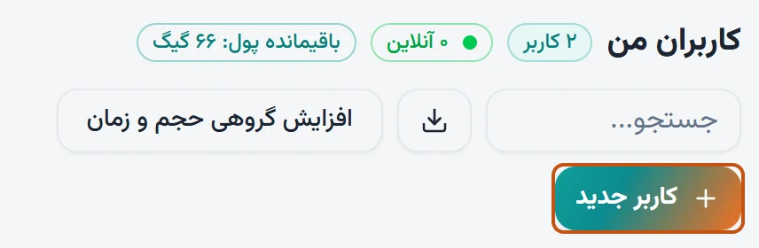

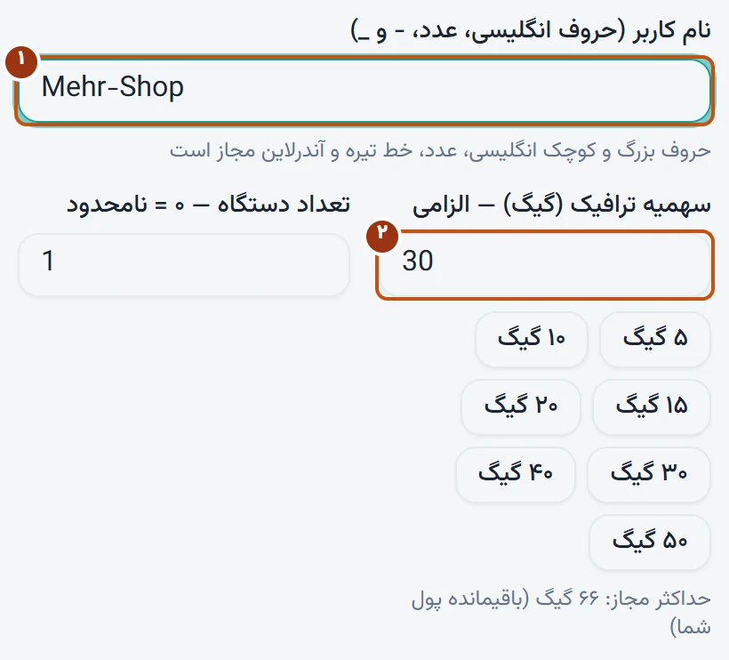

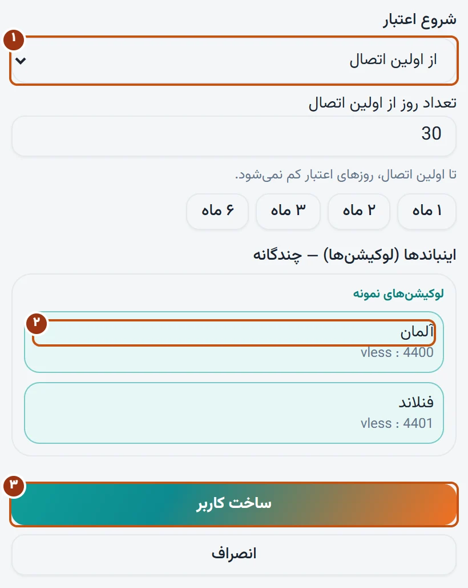

1. **کاربر جدید** را بزنید. برای یک حساب، «تعداد» را روی ۱ بگذارید و نام را وارد کنید. برای ساخت گروهی، تعداد تا ۵۰ و پیشوند نام را وارد کنید. نام کوچک زیر نام نمایشی، شناسهٔ داخلی مشتری برای جستجو و میرزا است.
2. سهمیه ترافیک را به گیگابایت وارد کنید. در پول محدود، سهمیهٔ مثبت لازم است. اگر گزینهٔ «تعداد دستگاه» را می‌بینید، مقدار ۰ یعنی محدودیتی تعیین نشود.
3. در «شروع اعتبار»، برای تاریخ ثابت تاریخ انقضا را انتخاب کنید. برای «از اولین اتصال»، تعداد روز اعتبار را وارد کنید تا شمارش از نخستین اتصال آغاز شود.
4. لوکیشن‌های موردنیاز را از فهرست مجاز انتخاب و **ساخت کاربر** را بزنید. در حساب مولتی‌لوکیشن می‌توانید چند مورد انتخاب کنید. اگر گزینه‌ای ناموجود شد، گزینه‌های ناموجود را از انتخاب بردارید و فهرست نهایی را بررسی کنید.
5. در ساخت گروهی پنجرهٔ نتیجهٔ هر حساب را بررسی کنید. اگر پیام ثبت حساب با آماده‌سازی ناتمام دیدید، نام را در فهرست و تب «پیگیری عملیات» جستجو کنید.

**جستجو، ترتیب و CSV.** با فیلد جستجو مشتری را پیدا کنید. روی سرستون «کاربر»، «ترافیک»، «انقضا» یا «وضعیت» بزنید تا ترتیب عوض شود. از «قبلی» و «بعدی» برای ورق‌زدن و از دکمهٔ **CSV** برای خروجی فهرست استفاده کنید. ستون «لوکیشن‌ها» مقصدهای حساب را نشان می‌دهد. نشان `+N` یعنی چند مقصد دیگر در همان ردیف وجود دارند. در «ترافیک» مصرف از کل سهمیه، در «انقضا» زمان باقی‌مانده و در «وضعیت» فعال‌بودن حساب را می‌بینید.

## آیکون‌های ردیف کاربر

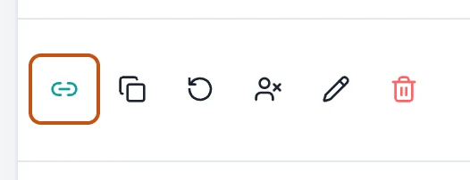

- **نقطهٔ سبز یا خاکستری کنار نام** وضعیت آنلاین یا آفلاین را نشان می‌دهد. با لمس نقطه می‌توانید IPهای ثبت‌شده را ببینید. **تقویم و ساعت** کنار همان نام برای تنظیم تمدید است.
- **زنجیر** پنجرهٔ «لینک‌ها و QR کاربر» را باز می‌کند. آنجا لینک اصلی ساب، QR، صفحه آمار کاربر و در صورت وجود لینک‌های اتصال تکی را دارید. در همین پنجره **لینک جدید** لینک قبلی را باطل می‌کند.
- **دو برگه** لینک اصلی ساب را کپی می‌کند. در پنجرهٔ لینک‌ها، دکمهٔ کپی کنار هر کانفیگ همان مورد را کپی می‌کند و دکمهٔ QR آن را برای اسکن نشان می‌دهد.
- **پیکان گرد** ریست ترافیک را درخواست می‌کند. اگر ریست قبلاً ثبت شده باشد، همان درخواست را پیگیری می‌کند. مصرف قبلی در حسابداری ثبت می‌شود و به پول نماینده برنمی‌گردد.
- **آدمک با ضربدر** حساب را فعال یا غیرفعال می‌کند. غیرفعال‌کردن دستی، تمدید خودکار را تا فعال‌سازی دستی یا شروع دستی دورهٔ تازه متوقف می‌کند.
- **مداد** برای تغییر نام/یادداشت، حجم، تاریخ، وضعیت و لوکیشن‌های مجاز است. گزینهٔ دستگاه فقط با دسترسی مربوط نمایش داده می‌شود. برای کاهش سهمیه، بیش از حجم مصرف‌نشده کم نکنید. مقدار قابل‌کسر پس از تأیید به موجودی پول برمی‌گردد.
- **سطل زباله** پنجرهٔ تأیید حذف را باز می‌کند. حذف، اتصال را قطع می‌کند. برای حساب تاریخ‌دار فقط پیش از هفتهٔ آخر، حجم مصرف‌نشده پس از تأیید حذف کامل برمی‌گردد. مصرف انجام‌شده در حساب ثبت می‌ماند.
- **مربع انتخاب** در ستون «پیگیری و گروه» ردیف را برای برچسب‌گذاری یا تغییر وضعیت گروهی انتخاب می‌کند. نشان درصد و نشان «نزدیک» به هشدار مصرف و انقضا مربوط‌اند.

روی گوشی نام و تقویم در ابتدای ردیف‌اند. برای زنجیر، کپی، ریست، وضعیت، ویرایش و حذف، جدول را افقی بکشید تا ستون «عملیات» دیده شود.

## گروه‌بندی، هشدار و افزایش گروهی

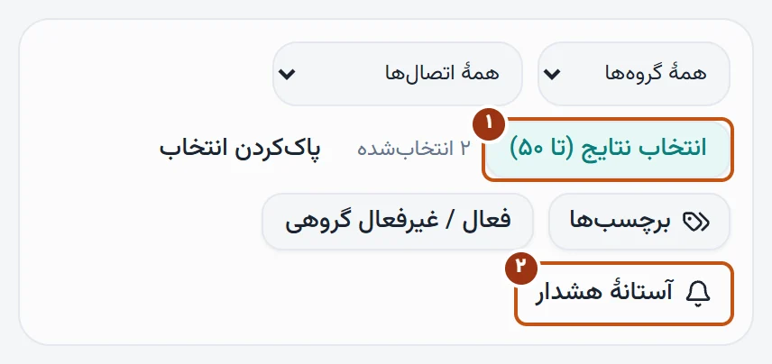

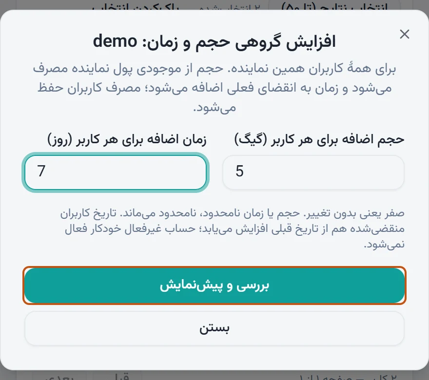

- **برچسب‌ها**. ردیف‌ها را تیک بزنید یا «انتخاب نتایج (تا ۵۰)» را بزنید. در «برچسب‌ها» فهرست برچسب‌ها را ذخیره کنید. برای پیدا کردن مشتری‌ها از فیلتر «همهٔ گروه‌ها» یا فیلتر «همهٔ اتصال‌ها» استفاده کنید.
- **فعال / غیرفعال گروهی**. مشتری‌های انتخاب‌شده را بررسی کنید، وضعیت جدید را انتخاب و نتیجهٔ هر ردیف را بخوانید. اگر کار نیمه‌تمام بود، «ادامهٔ تغییر وضعیت ناقص» را بزنید.
- **آستانهٔ هشدار** با آیکون زنگ. درصد مصرف و روز مانده تا انقضا را وارد کنید. برای ارسال هشدار، بات اعلان تلگرام در «تنظیمات حساب» باید فعال باشد.
- **افزایش گروهی حجم و زمان**. این عملیات روی همهٔ مشتریان واجد شرایط همین نمایندگی اجرا می‌شود. گیگ و روز اضافه برای هر کاربر را بزنید. ۰ یعنی آن مورد تغییر نکند. با «بررسی و پیش‌نمایش» تعداد کاربران و حجم لازم را ببینید و سپس تأیید کنید. حجم از باقی‌ماندهٔ پول نماینده تخصیص می‌یابد و مصرف قبلی حفظ می‌شود. تاریخ قبلی مبنای افزایش روز است و این عمل حساب غیرفعال را خودکار فعال نمی‌کند.

## بسته‌های آماده برای ساخت کاربر

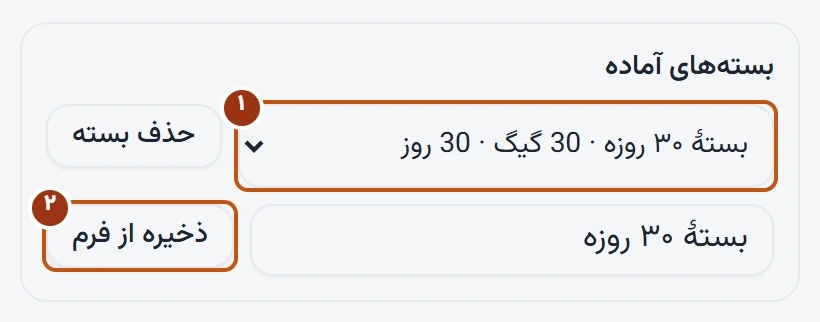

**مسیر نماینده** › کاربران من › کاربر جدید › بسته‌های آماده

1. در فرم ساخت، سهمیه، مدت یا تاریخ پایان، نحوهٔ شروع اعتبار و لوکیشن‌های مجاز را وارد کنید. در صورت دسترسی، محدودیت دستگاه را هم تنظیم کنید.
2. در «بسته‌های آماده» یک نام مثل «۱۰ گیگ ۳۰ روز» بدهید و **ذخیره از فرم** را بزنید.
3. برای مشتری بعدی، فرم «کاربر جدید» را باز و از فهرست **انتخاب بسته**، بسته را انتخاب کنید. پس از پر شدن فرم، نام کاربر و تعداد را وارد و ساخت را تأیید کنید. تعداد بیشتر از ۱، ساخت گروهی است.
4. برای تغییر بسته، آن را انتخاب کنید، فرم را عوض کنید و با همان نام **ذخیره از فرم** را بزنید. برای برداشتن آن از فهرست، **حذف بسته** را بزنید. اشتراک‌های قبلاً ساخته‌شده تنظیمات خودشان را نگه می‌دارند.

اگر «ذخیره از فرم» غیرفعال است، نام، حجم مثبت، مدت معتبر و دست‌کم یک لوکیشن را وارد کنید. پنل هنگام ساخت، موجودی و دسترسی فعلی به لوکیشن‌ها را دوباره بررسی می‌کند.

**استفاده در میرزا** › از بستهٔ آماده یک کاربر نمونه با لوکیشن‌های مدنظر بسازید. در میرزا، در «تنظیم پروتکل و اینباند» نام کاربری داخلی همین مشتری را بفرستید. حجم و مدت بسته را در محصول میرزا وارد کنید. حجم محصول پولی به گیگابایت و حجم اکانت تست به مگابایت صحیح و مثبت است. [آموزش تصویری اتصال میرزا](https://npanel.softarg.ir/guide/mirza-bot)

## پیگیری ساخت، ویرایش، تمدید و حذف

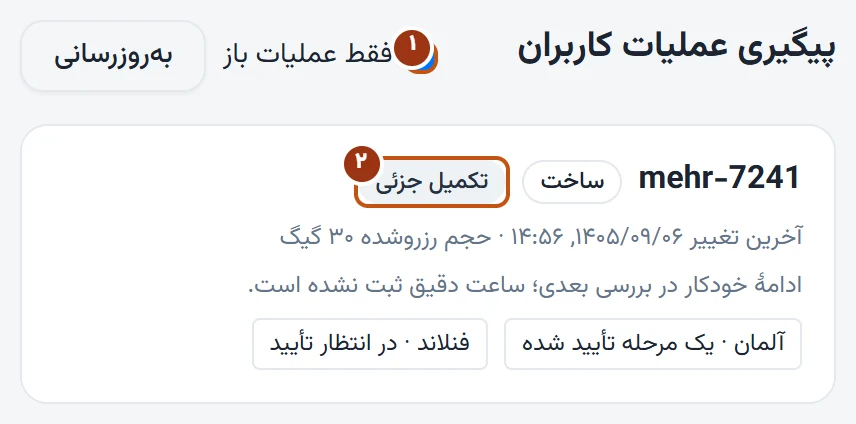

**مسیر نماینده و ادمین** › پیگیری عملیات

1. «فقط عملیات باز» به‌صورت پیش‌فرض روشن است. برای دیدن عملیات بسته‌شده، تیک آن را بردارید.
2. نام کاربر، نوع عملیات، زمان آخرین تغییر و نتیجهٔ هر مقصد را در کارت مربوطه بخوانید. «حجم رزروشده» یعنی بخشی از ظرفیت تا روشن‌شدن نتیجه برای همان عملیات کنار گذاشته شده است. «حسابداری ثبت شده» یعنی ثبت مالی آن عملیات انجام شده است.
3. **به‌روزرسانی** را بزنید تا وضعیت تازه را ببینید. اگر ساخت حساب «در انتظار» یا «تکمیل جزئی» است، همان نام را در «کاربران من» هم جستجو کنید. دوباره همان مشتری را به‌عنوان سفارش جدید نسازید.
4. اگر پیام «ادامهٔ خودکار» می‌بینید، پنل دوباره بررسی می‌کند. اگر «نیاز به بررسی» باقی ماند، نام کاربر، نوع عملیات و زمان آخرین تغییر را به ادمین بدهید. این صفحه برای مشاهدهٔ وضعیت است.

نماینده فقط عملیات خودش و نام مقصدهای مجاز را می‌بیند. ادمین می‌تواند عملیات نماینده‌ها را کنار هم بررسی کند.

## آخرین دریافت ساب و آخرین اتصال

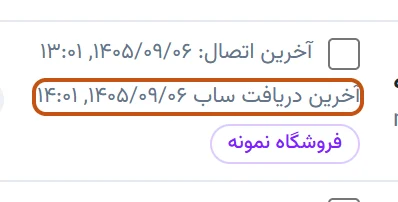

**مسیر نماینده** › کاربران من › ستون «پیگیری و گروه» کنار ردیف مشتری

- **آخرین دریافت ساب** نشان می‌دهد اشتراک چه زمانی با موفقیت از پنل مبدأ دریافت شده است. بازکردن کانفیگ از داشبورد هم ممکن است این زمان را تازه کند.
- **آخرین اتصال** و **اکنون آنلاین** به وضعیت اتصال مشتری مربوط‌اند. برای بررسی وصل‌شدن مشتری، این دو شاخص را ببینید.
- **دریافت ساب ثبت نشده** یعنی در آمار موجود دریافت موفقی ثبت نشده است. **آخرین دریافت ساب نامشخص** یعنی پنل هنوز دادهٔ قابل‌اتکا برای آن مشتری ندارد.

## صفحهٔ مشتری و پشتیبانی تلگرام

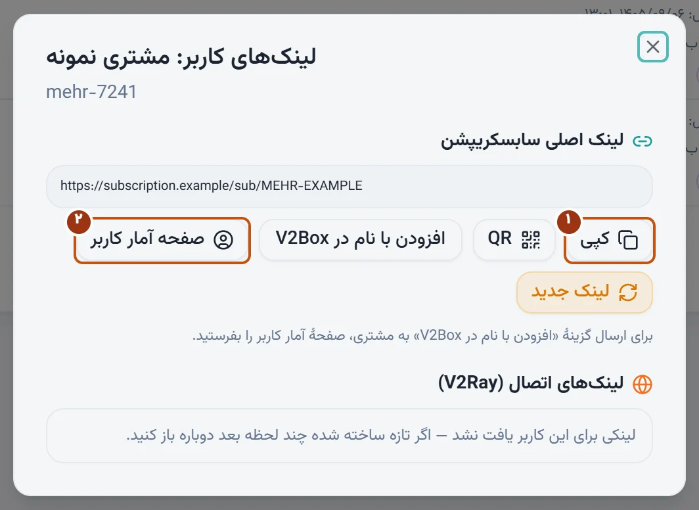

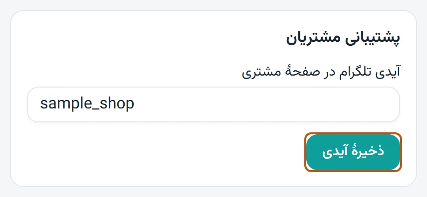

**مسیر نماینده برای ساخت لینک مشتری** › کاربران من › عملیات › «لینک‌ها و QR کاربر» › صفحه آمار کاربر

1. «صفحه آمار کاربر» را باز کنید و نشانی همان صفحه را برای مشتری بفرستید. «لینک اصلی سابسکریپشن» هم در پنجرهٔ لینک‌ها برای کپی و واردکردن در برنامهٔ مشتری آماده است.
2. مشتری در صفحهٔ خودش، در **راهنمای اتصال** سیستم‌عامل را انتخاب می‌کند و روش واردکردن لینک را می‌بیند. برای V2Box، وقتی این گزینه نمایش داده می‌شود، می‌تواند **افزودن با نام در V2Box** را بزند.
3. برای نمایش **پیام به پشتیبانی** در صفحهٔ مشتری، در پنل نماینده به **پشتیبانی › پشتیبانی مشتریان** بروید، «آیدی تلگرام در صفحهٔ مشتری» را وارد کنید و **ذخیرهٔ آیدی** را بزنید. سپس صفحهٔ همان مشتری را باز کنید و مقصد دکمه را بررسی کنید.

**مسیر ادمین برای نمایندهٔ غیرفعال** › تنظیمات و پنل‌ها › پشتیبانی نماینده‌ها. «آیدی تلگرام پشتیبانی» اینجا مقصد دکمه‌ای است که نمایندهٔ غیرفعال هنگام ورود می‌بیند.

## حساب همکار پشتیبانی

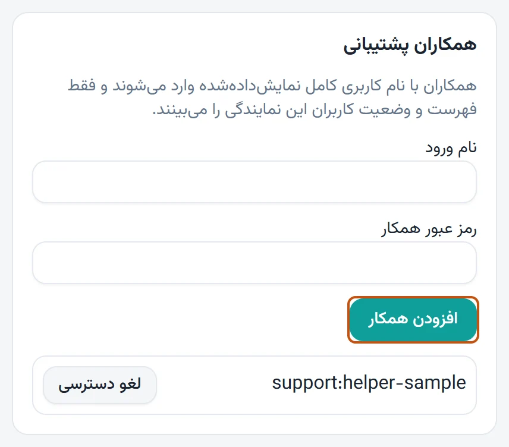

**مسیر نماینده** › پشتیبانی › همکاران پشتیبانی

1. اگر روی گوشی تب «پشتیبانی» را نمی‌بینید، نوار تب‌ها را افقی بکشید.
2. «نام ورود» و رمز عبور حداقل ۱۲ نویسه‌ای وارد کنید و **افزودن همکار** را بزنید.
3. نام ورود کاملِ نمایش‌داده‌شده با پیشوند `support:` را به همکار بدهید. همکار با نام کامل و رمز خودش از صفحهٔ ورود پنل وارد می‌شود.
4. در «کاربران نماینده»، همکار می‌تواند فهرست کاربران، وضعیت فعال‌بودن و انقضا را ببیند. برای قطع دسترسی، کنار نام او **لغو دسترسی** را بزنید و تأیید کنید. نشست باز هم اعتبارش را از دست می‌دهد.

## آمار و مصرف

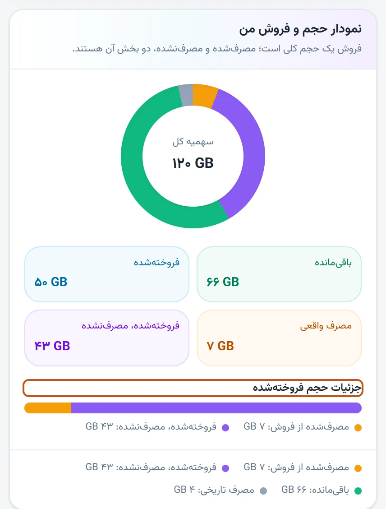

کارت‌های بالای صفحه تعداد کاربران، حساب‌های فعال، منقضی یا پُر و مصرف کل را نشان می‌دهند. در نمودار سهمیه، «فروخته‌شده» حجم تخصیص داده‌شده به مشتری‌های فعلی است. «فروخته، مصرف‌نشده» بخش استفاده‌نشدهٔ همان فروش است. «مصرف واقعی» مصرف ثبت‌شدهٔ کاربران فعلی و «باقی‌مانده» ظرفیت آزاد برای تخصیص بعدی است. مصرف تاریخی و رزرو عملیات هم جداگانه دیده می‌شوند. اگر عددی نامشخص است، پس از دریافت آمار زنده دوباره بررسی کنید.

نمودارهای پایین صفحه را برای مقایسهٔ مصرف لوکیشن‌ها، تعداد کاربران و کاربران پرمصرف بخوانید. «دسترسی‌های حساب شما» امکانات فعال‌شده برای نمایندگی را نشان می‌دهد.

## برند و دامنه اختصاصی

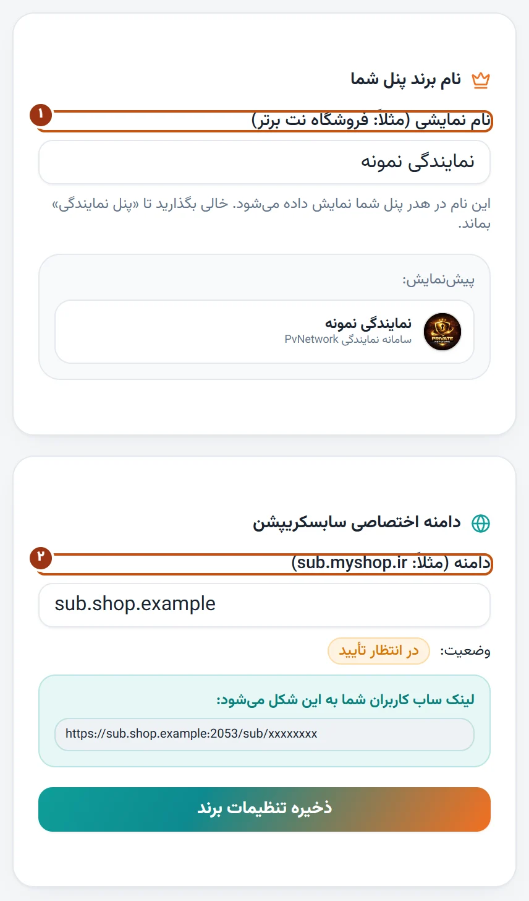

1. «برند و دامنه» را باز کنید. اگر وایت‌لیبل برای حسابتان فعال است، **نام نمایشی** را بنویسید و پیش‌نمایش هدر را بررسی کنید.
2. در صورت نیاز، دامنهٔ اختصاصی را وارد و **ذخیره تنظیمات برند** را بزنید.
3. برای تأیید مالکیت، مقدار رکورد TXT و راهنمای DNS همین کارت را از پنل کپی کنید. پس از ثبت DNS، **بررسی و تأیید دامنه** را بزنید و وضعیت «تأییدشده» را بررسی کنید. برای رفع «در انتظار تأیید»، نام و مقدار رکورد را با مقادیر نمایش‌داده‌شده تطبیق دهید.
4. یک لینک آزمایشی جدید را از پنجرهٔ لینک‌ها بردارید و بازشدن آن را بررسی کنید. برای ابطال لینک یک مشتری، دکمهٔ جداگانهٔ «لینک جدید» در پنجرهٔ همان مشتری قرار دارد.

## تنظیمات حساب و ربات‌ها

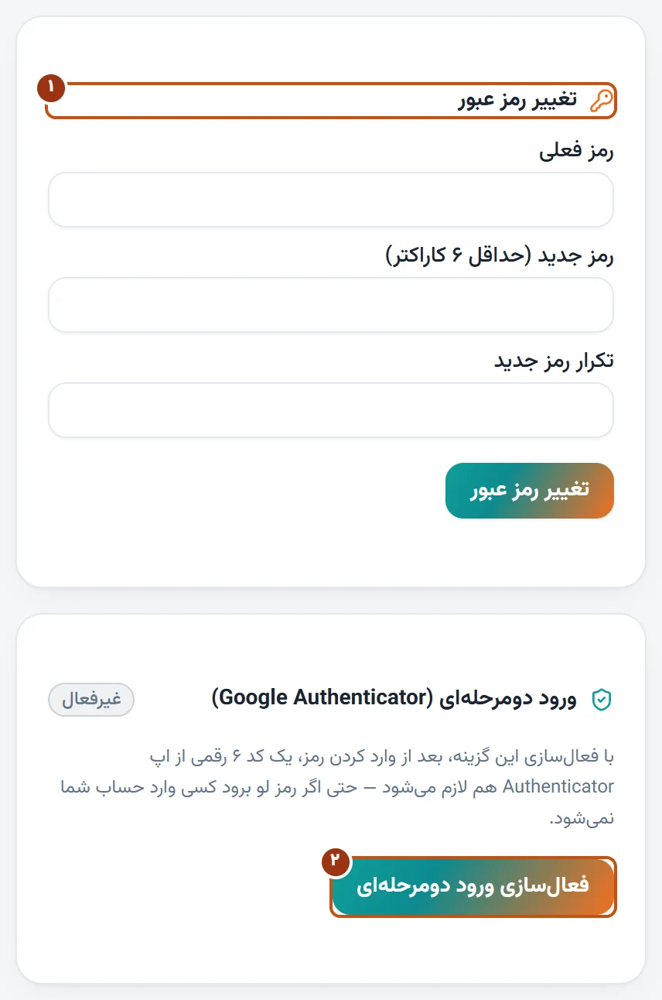

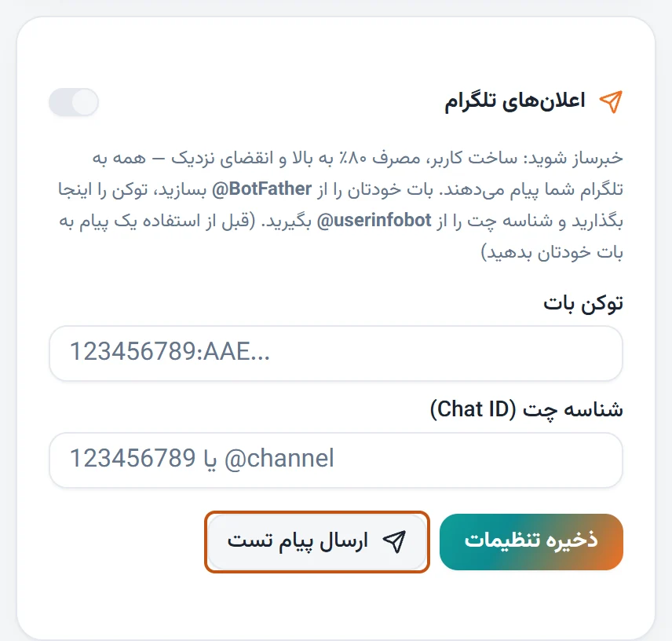

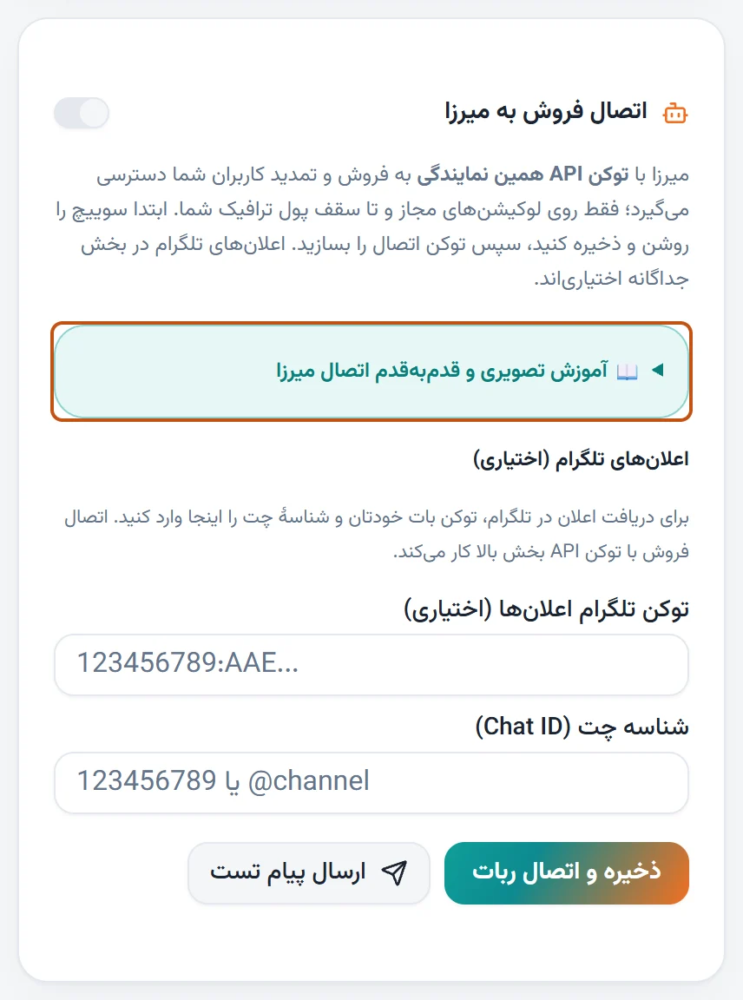

- **تغییر رمز عبور**. رمز فعلی، رمز جدید و تکرار آن را وارد و ثبت کنید. نام کاربری نمایندگی همان نامی است که در هدر حساب می‌بینید.
- **ورود دومرحله‌ای**. «فعال‌سازی ورود دومرحله‌ای» را بزنید، QR را در برنامهٔ Authenticator اسکن کنید و کد شش‌رقمی را در پنل تأیید کنید. برای ورودهای بعدی کد همان برنامه را وارد کنید.
- **اعلان‌های تلگرام** با آیکون ارسال. این گزینه را روشن کنید، توکن بات و شناسهٔ چت خود را وارد و «ذخیره تنظیمات» را بزنید. یک پیام به بات بدهید و «ارسال پیام تست» را بزنید. آستانهٔ مصرف و انقضا در «کاربران من» تنظیم می‌شود.
- **اتصال فروش به میرزا** با آیکون ربات. سوییچ اتصال را روشن و ذخیره کنید. نشانی Panel URL و توکن API فروش را از همان کارت بردارید. برای تنظیم لوکیشن‌ها، نام داخلی کاربر نمونه را بدهید و برای «دامنه لینک ساب»، لینک اصلی و کامل همان کاربر را ارسال کنید. نتیجه را با ساخت یک اشتراک آزمایشی بسنجید. «بررسی لوکیشن‌های قابل فروش» فهرست مقصدهای مجاز را نشان می‌دهد. [آموزش تصویری اتصال میرزا](https://npanel.softarg.ir/guide/mirza-bot)
- **کپی توکن API فروش** فقط وقتی در دسترس است که توکن در همان نشست نمایش داده می‌شود. «تعویض» یا «لغو» توکن، کلید قبلی را بی‌اعتبار می‌کند. برای ادامهٔ فروش پس از تعویض، توکن جدید را در تنظیمات میرزا ثبت کنید.

## وب‌هوک رویدادهای اشتراک

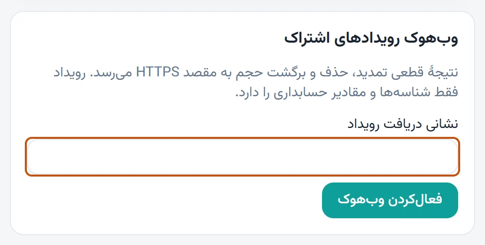

**مسیر ادمین** › تنظیمات و پنل‌ها › وب‌هوک رویدادهای اشتراک

1. نشانی عمومی HTTPS سامانهٔ دریافت‌کننده را در «نشانی دریافت رویداد» وارد کنید و **فعال‌کردن وب‌هوک** را بزنید.
2. کلید امضا را همان لحظه برای تنظیم دریافت‌کننده کپی کنید. پنل کلید را فقط هنگام صدور یا تعویض نشان می‌دهد.
3. پس از یک عملیات آزمایشیِ تأییدشده، در «آخرین ارسال‌ها» **بازخوانی** را بزنید و وضعیت «تحویل شد»، «در انتظار ارسال» یا «ارسال ناموفق» را ببینید.
4. «تعویض کلید»، تغییر نشانی و «خاموش‌کردن» بر ارسال‌های معطل مقصد قبلی اثر دارند. بعد از بازیابی بکاپ روی نصب تازه، فعال‌سازی برای همان نصب انجام می‌شود.

دریافت‌کننده رویداد تمدید، حذف تأییدشده و برگشت حجم ثبت‌شده را دریافت می‌کند. دستور بررسی امضا و شناسهٔ رویداد در بخش فنی آمده است.

## جزئیات فنی وب‌هوک و میرزا

**وب‌هوک**. مقصد یک HTTPS عمومی با پورت استاندارد است. هدر `X-PVNet-Signature` با HMAC-SHA256 روی `timestamp + "." + rawBody` بررسی می‌شود. زمان از `X-PVNet-Timestamp` و شناسهٔ ثابت از `X-PVNet-Event-Id` می‌آید. زمان را اعتبارسنجی کنید و شناسهٔ رویداد را برای جلوگیری از پردازش دوباره ذخیره کنید. پاسخ HTTP از ۲۰۰ تا ۲۹۹ یعنی تحویل موفق.

رویدادها `subscription.renewed`، `subscription.deleted` و `quota.refunded` هستند. بدنه شامل `id`، `event`، `at`، `resellerId`، `customerId` و `data` است. رویداد برگشت، سهمیه‌ای را گزارش می‌کند که حسابداری پنل ثبت کرده است.

**بسته در پل میرزا**. مسیرهای استاندارد میرزا مقادیر خود سفارش را ارسال می‌کنند. کلاینتی که قابلیت انتخاب مستقیم بسته دارد، با نشست یا توکن فعلی پل از این دو مسیر استفاده می‌کند.

- `GET /api/bridge/<reseller>/panel/api/pvnetwork/plans` شناسه، نام، حجم، مدت و نوع شروع اعتبار بسته‌ها را برمی‌گرداند.
- `POST /api/bridge/<reseller>/panel/api/pvnetwork/plans/create` بدنهٔ JSON حاوی `planId`، `email` و `requestId` می‌گیرد. هنگام تکرار همان سفارش، همان شناسهٔ درخواست را بفرستید. پاسخ تکرار، سهمیه و شناسهٔ اشتراک همان سفارش را حتی پس از ویرایش یا حذف بسته برمی‌گرداند. `nodePending` یعنی حساب ثبت شده و آماده‌سازی مقصد هنوز ادامه دارد.
